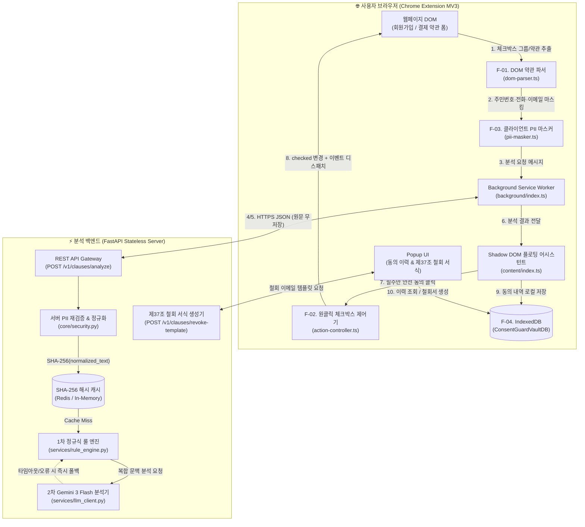
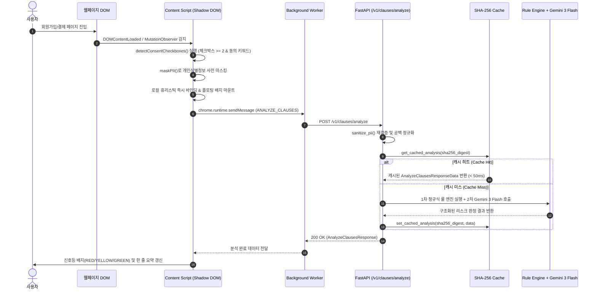
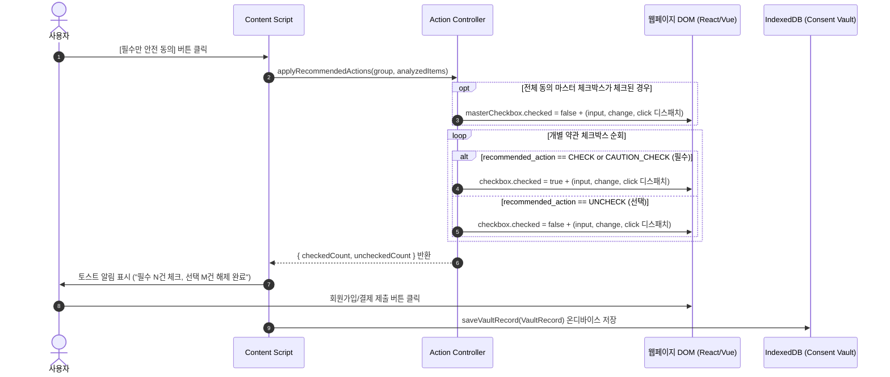
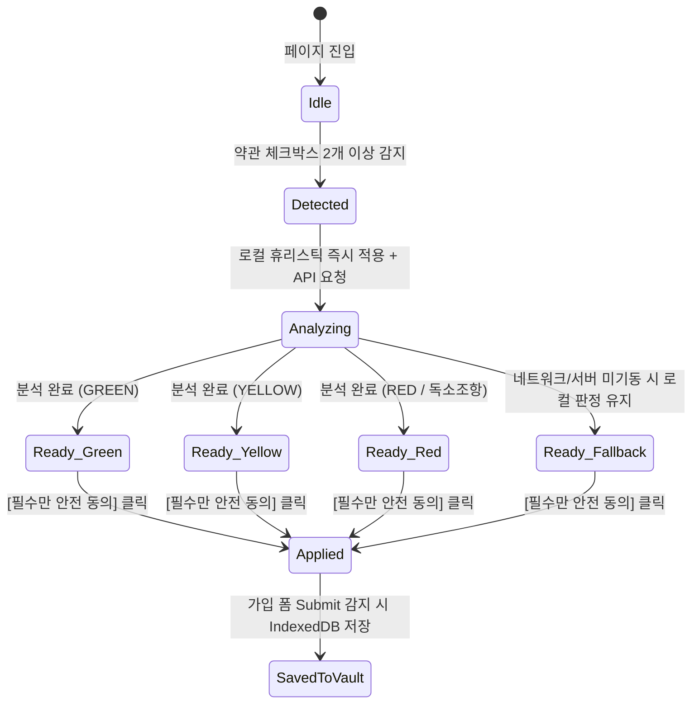
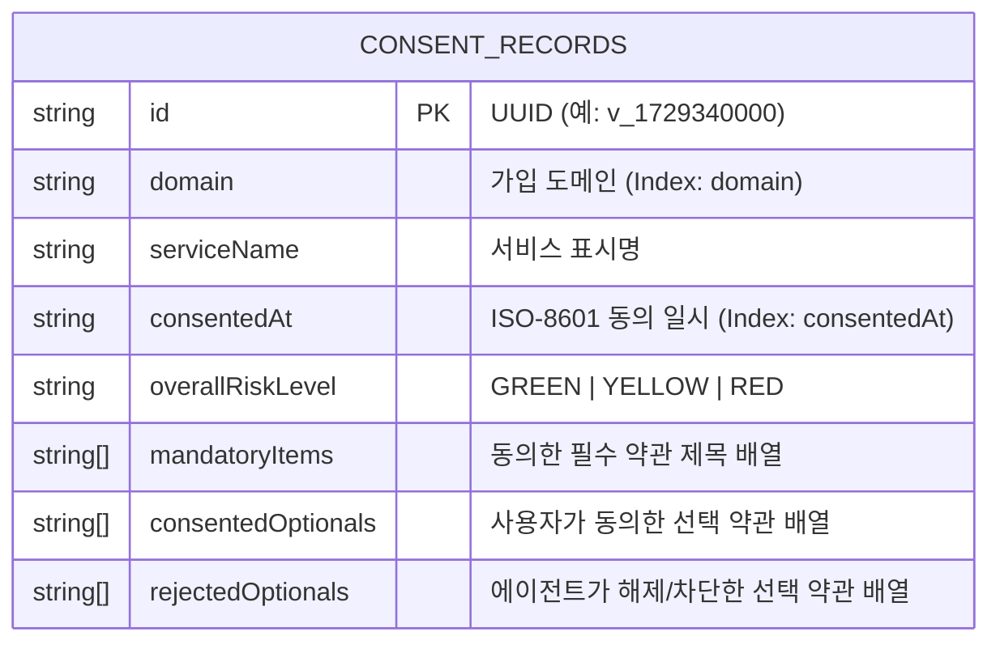
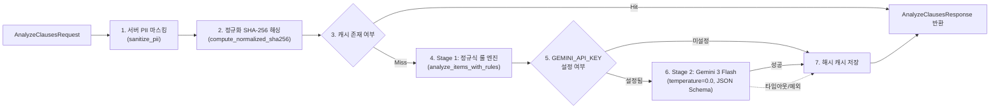

# 🏗️ ConsentGuard AI — 상세 기술 아키텍처 설계서 (Low-Level Design)

> **문서 버전**: v1.0.0  
> **상위 문서**: [`consentguard_ai.md`](../consentguard_ai.md) (마스터 기획서), [`AGENTS.md`](../AGENTS.md) (하네스 규칙)  
> **대상 모듈**: `packages/shared-schema`, `apps/chrome-extension`, `apps/api-server`

---

## 1. 시스템 전체 아키텍처 (System Overview)

**ConsentGuard AI**는 사용자의 민감한 개인정보와 동의 이력을 외부 서버에 남기지 않는 **온디바이스 우선(On-Device First) + 무저장(Zero-Retention) 하이브리드 아키텍처**를 채택합니다.



---

## 2. 핵심 시나리오별 시퀀스 다이어그램 (Sequence Diagrams)

### 2.1 실시간 약관 감지 및 하이브리드 리스크 분석 흐름



### 2.2 원클릭 `'필수만 안전 동의'` 제어 및 동의 보관함(Vault) 기록 흐름



---

## 3. 크롬 익스텐션 상세 설계 (`apps/chrome-extension`)

### 3.1 웹 DOM 약관 파서 설계 ([`dom-parser.ts`](../apps/chrome-extension/src/utils/dom-parser.ts))

국내 회원가입 및 결제 폼의 다양성을 처리하기 위해 3단계 휴리스틱 탐지 규칙을 적용합니다.

| 패턴 유형 | DOM 구조 특징 | 파싱 및 추출 전략 |
| :--- | :--- | :--- |
| **Pattern A (인라인형)** | `<input type="checkbox">` + `<label>` + 하단 스크롤 박스(`textarea`, `div.scroll`) | 체크박스 컨테이너 내 제목과 스크롤 박스 본문 텍스트를 함께 추출 |
| **Pattern B (모달/링크형)** | 체크박스 + `[필수] 이용약관 동의` + `<button>전문보기</button>` | 라벨 제목과 인접 요약문 우선 추출, 상세 모달 오픈 시 `MutationObserver`로 본문 보강 |
| **Pattern C (SPA 동적 폼)** | React/Next.js/Vue 기반 비동기 렌더링 가입 폼 | `DOMContentLoaded` 이후 `MutationObserver`(300ms 디바운스)로 신규 체크박스 그룹 감지 |

#### 마스터 체크박스 분리 알고리즘
* 컨테이너 텍스트에 `['전체 동의', '모두 동의', '전체동의', '일괄 동의']`가 포함된 첫 번째 체크박스를 `masterCheckbox`로 지정하고, 분석 대상(`items`)에서는 제외하여 개별 약관만 정확히 평가합니다.

### 3.2 가상 DOM 호환 체크박스 제어기 ([`action-controller.ts`](../apps/chrome-extension/src/utils/action-controller.ts))

React 16+, Vue 3, Angular 등의 프레임워크는 `input.checked = true` 단순 속성 변경만으로는 내부 `state`를 업데이트하지 않는 경우가 있습니다. 이를 해결하기 위해 다음 절차로 상태를 동기화합니다.

1. 대상 체크박스의 현재 `checked` 상태가 목표 상태(`shouldBeChecked`)와 다를 때만 실행하여 불필요한 토글 역전을 방지합니다.
2. `checkbox.checked = shouldBeChecked` 할당 후 버블링(`bubbles: true`)이 활성화된 이벤트를 순서대로 발생시킵니다:
   * `new Event('input', { bubbles: true })`
   * `new Event('change', { bubbles: true })`
   * `new Event('click', { bubbles: true })`

### 3.3 Shadow DOM UI 상태 전이 (`stateDiagram-v2`)

호스트 웹페이지의 CSS 오염을 막기 위해 `#consentguard-root`에 `attachShadow({ mode: 'open' })`를 생성하고 다음 상태 머신에 따라 UI를 렌더링합니다.



### 3.4 Content Script ↔ Background 메시지 프로토콜

HTTPS 쇼핑몰 페이지에서 로컬 개발 서버(`http://localhost:8000`)나 외부 API 서버로 직접 `fetch`할 때 발생하는 CORS 및 Mixed Content 차단을 우회하기 위해 모든 네트워크 요청은 Background Service Worker([`background/index.ts`](../apps/chrome-extension/src/background/index.ts))가 대행합니다.

```typescript
// Message Request Contract
export type ExtensionMessage =
  | { type: 'CG_ANALYZE_CLAUSES'; payload: AnalyzeClausesRequest }
  | { type: 'CG_GENERATE_REVOKE'; payload: RevokeTemplateRequest };
```

### 3.5 온디바이스 동의 보관함 데이터 모델 ([`vault-db.ts`](../apps/chrome-extension/src/utils/vault-db.ts))

브라우저 내장 `IndexedDB`(`ConsentGuardVaultDB`, 버전 `1`)의 `consent_records` 오브젝트 스토어 구조입니다.



---

## 4. 백엔드 하이브리드 분석 엔진 상세 설계 (`apps/api-server`)

### 4.1 2-Stage 하이브리드 분석 파이프라인

비용 절감, 응답 속도(Latency), 그리고 LLM 장애 시 100% 가용성을 보장하기 위해 **정규식 1차 룰 엔진**과 **Gemini 3 Flash 2차 분석기**를 결합합니다.



### 4.2 1차 룰 엔진([`rule_engine.py`](../apps/api-server/app/services/rule_engine.py)) 탐지 매트릭스

| 카테고리 (`IssueCategory` / `DarkPattern`) | 핵심 탐지 패턴 (정규식/키워드) | 기본 위험도 | 권장 액션 (`MANDATORY` / `OPTIONAL`) |
| :--- | :--- | :---: | :---: |
| `COPYRIGHT_INFRINGE` (저작권 귀속) | `저작재산권`, `영구 귀속`, `영구히 양도`, `저작인격권` | `RED` | `CAUTION_CHECK` / `UNCHECK` |
| `UNFAIR_EXEMPTION` (포괄적 면책) | `일체의 책임을 부담하지`, `배상하지 않으며`, `책임을 면합니다` | `RED` | `CAUTION_CHECK` / `UNCHECK` |
| `THIRD_PARTY_OVEREXPOSURE` (제3자 과다 제공) | `제3자`, `보험`, `제휴 금융`, `텔레마케팅` | `RED` | `CAUTION_CHECK` / `UNCHECK` |
| `REFUND_RESTRICTION` (환불/청약철회 제한) | `환불이 일체 불가`, `환불 불가`, `위약금 30%` | `RED` | `CAUTION_CHECK` / `UNCHECK` |
| `MARKETING_OPT_IN` (광고/야간 마케팅 수신) | `광고`, `마케팅`, `SMS`, `푸시`, `할인 쿠폰` | `YELLOW` | `CHECK` / `UNCHECK` |
| `HIDDEN_RENEWAL` (다크패턴: 숨은 갱신) | `자동 정기 결제`, `별도 통지 없이`, `자동 결제 전환` | `RED` | 다크패턴 경고 배너 표시 |
| `PRE_SELECTED` (다크패턴: 사전 체크) | `clause_type == 'OPTIONAL'` 이면서 `is_pre_checked == True` | `YELLOW` | 즉시 `UNCHECK` 해제 |
| `CANCELLATION_BARRIER` (다크패턴: 해지 방해) | `환불 불가`, `위약금`, `중도 해지 불가` | `RED` | 다크패턴 경고 배너 표시 |

---

## 5. 보안 및 법률 컴플라이언스 상세 설계

### 5.1 이중 PII 마스킹 파이프라인 (Double Defense PII Masking)
사용자가 회원가입 폼에 입력한 개인정보가 DOM 텍스트 추출 과정에서 섞여 들어가는 것을 방지하기 위해 클라이언트([`pii-masker.ts`](../apps/chrome-extension/src/utils/pii-masker.ts))와 서버([`security.py`](../apps/api-server/app/core/security.py)) 양단에서 동일한 정규식 필터를 수행합니다.

* **주민등록번호/외국인등록번호**: `\b\d{6}-[1-4]\d{6}\b` $\rightarrow$ `[MASKED_RRN]`
* **휴대전화번호**: `\b01[016789]-\d{3,4}-\d{4}\b` $\rightarrow$ `[MASKED_PHONE]`
* **이메일 주소**: `\b[\w.-]+@[\w.-]+\.\w+\b` $\rightarrow$ `[MASKED_EMAIL]`

### 5.2 변호사법 제109조 방어를 위한 표현 가이드라인
AI 프롬프트([`prompt.py`](../apps/api-server/app/core/prompt.py))와 룰 엔진 설명문 작성 시 아래 표현 변환 규칙을 강제합니다.

| ❌ 금지 표현 (단정적 법률 판단) | ✅ 허용/권장 표현 (표준약관 비교 및 소비자 주의 안내) |
| :--- | :--- |
| `"이 조항은 약관규제법 위반으로 무효입니다."` | `"공정위 표준약관 대비 소비자에게 불리할 소지가 있어 주의가 필요합니다."` |
| `"불법적인 개인정보 수집 조항입니다."` | `"서비스 본질적 기능 대비 과도한 정보가 제3자에게 제공될 수 있습니다."` |
| `"위법한 환불 불가 규정입니다."` | `"전자상거래법 및 소비자분쟁해결기준 대비 청약철회 권리가 제한될 소지가 있습니다."` |
